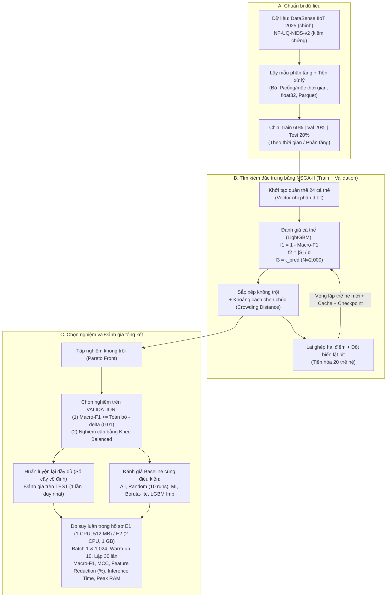

# TRƯỜNG ĐẠI HỌC CÔNG NGHỆ TP. HỒ CHÍ MINH (HUTECH)
## KHOA CÔNG NGHỆ THÔNG TIN

---

# ĐỀ CƯƠNG ĐỀ TÀI ĐỒ ÁN CHUYÊN NGÀNH

### THÔNG TIN CHUNG:
- **Sinh viên/Nhóm thực hiện:**
  1. Nguyễn Thành Danh &emsp;&emsp; MSSV: 2380600275 &emsp;&emsp; Lớp: 23DTHC6
  2. Vũ Đức Nam &emsp;&emsp;&emsp;&emsp;&emsp; MSSV: 2380614839 &emsp;&emsp; Lớp: 23DTHD5
  3. Nguyễn Minh Nhật &emsp;&emsp;&emsp; MSSV: 2380601551 &emsp;&emsp; Lớp: 23DTHC5
- **Giảng viên hướng dẫn:** ThS. Nguyễn Trọng Minh Hồng Phước
- **Tên đề tài:** Lựa chọn đặc trưng đa mục tiêu bằng NSGA-II cho hệ thống phát hiện xâm nhập trên thiết bị tài nguyên hạn chế

---

### NỘI DUNG ĐỀ CƯƠNG:

#### 1. Giới thiệu
Cùng với sự phát triển nhanh của Internet vạn vật (IoT) và Internet vạn vật công nghiệp (IIoT), số lượng thiết bị kết nối mạng tăng mạnh, kéo theo nguy cơ bị tấn công mạng ngày càng lớn. Hệ thống phát hiện xâm nhập (IDS) dựa trên học máy là giải pháp phổ biến để nhận diện lưu lượng bất thường, trong đó lưu lượng mạng thường được biểu diễn dưới dạng các luồng (flow) với hàng chục đặc trưng thống kê như số gói tin, số byte, thời gian luồng, cờ TCP,... Tuy nhiên, nhiều thiết bị biên và thiết bị IoT/IIoT có bộ nhớ, năng lực tính toán và năng lượng hạn chế. Việc sử dụng toàn bộ đặc trưng không chỉ tốn chi phí trích xuất và suy luận mà còn có thể chứa các đặc trưng dư thừa, gây nhiễu cho mô hình.

Chọn lọc đặc trưng (feature selection) là hướng tiếp cận nhằm giảm số chiều dữ liệu nhưng vẫn giữ được chất lượng phát hiện [6]. Các phương pháp phổ biến như Mutual Information, Boruta hay độ quan trọng đặc trưng của mô hình cây thường chỉ tối ưu một tiêu chí, trong khi bài toán IDS trên thiết bị hạn chế đòi hỏi cân bằng đồng thời nhiều mục tiêu mâu thuẫn nhau: độ chính xác phát hiện cao, số đặc trưng ít và chi phí suy luận thấp. Đây là bài toán phù hợp với tối ưu đa mục tiêu. Trong đề tài này, nhóm nghiên cứu chọn đặc trưng đa mục tiêu bằng thuật toán NSGA-II [1] kết hợp bộ phân lớp LightGBM [2], trong đó thời gian suy luận đo thực tế được đưa trực tiếp vào hàm mục tiêu và được đánh giá trong môi trường giới hạn tài nguyên được xác định rõ.

**Về tính mới:** công trình gốc của bộ dữ liệu DataSense IIoT 2025 [3] đã đề xuất một khung chọn đặc trưng đa mục tiêu nhiều giai đoạn (nhóm đặc trưng theo ngữ cảnh, Sparse Group Lasso, điểm thông tin RRS, sau đó NSGA-II). Theo mô tả thuật toán trong [3], các mục tiêu của bước NSGA-II gồm MCC, độ hữu ích thông tin của tập đặc trưng và kích thước tập con; phần tài nguyên (thời gian huấn luyện/đánh giá, mức sử dụng tài nguyên) được khảo sát sau khi đã chọn đặc trưng. Do đó nhóm không xem việc dùng NSGA-II là đóng góp mới. Điểm khác biệt mà đề tài hướng tới và sẽ kiểm chứng bằng thực nghiệm là: 
1. Đưa thời gian suy luận của mô hình LightGBM vào làm mục tiêu tối ưu trực tiếp;
2. Tìm kiếm trực tiếp trên không gian đặc trưng đầu vào (kiểu wrapper), không qua các bước nhóm ngữ cảnh và Sparse Group Lasso, để xem một khung đơn giản hơn có cho mức đánh đổi tương đương hay không;
3. Đo hiệu năng trong môi trường giới hạn CPU/RAM xác định rõ và chọn nghiệm cuối theo quy tắc cố định trên tập validation;
4. So sánh với các baseline (gồm cả chọn ngẫu nhiên) ở cùng số lượng đặc trưng và cùng ngân sách thời gian suy luận, kèm kiểm chứng khả năng áp dụng trên NF-UQ-NIDS-v2. 

Nếu kết quả cho thấy phương pháp không tốt hơn các baseline hoặc không tốt hơn kết quả của [3], nhóm vẫn báo cáo trung thực và phân tích nguyên nhân. Nhóm sẽ đối chiếu chi tiết với các phần 4 và 5 của [3] trong suốt quá trình triển khai.

---

#### 2. Mục tiêu của đề tài
- Nghiên cứu tổng quan về IDS dựa trên học máy, đặc trưng luồng mạng (NetFlow) và các nhóm phương pháp chọn đặc trưng (filter, wrapper, embedded); khảo sát công trình gốc DataSense IIoT 2025 [3] để làm rõ điểm khác biệt của phương pháp đề xuất.
- Xây dựng khung chọn đặc trưng đa mục tiêu bằng NSGA-II, tối ưu đồng thời ba mục tiêu: tối đa Macro-F1, tối thiểu số đặc trưng và tối thiểu thời gian suy luận (inference time), với LightGBM làm bộ phân lớp.
- Xác định môi trường mô phỏng thiết bị tài nguyên hạn chế (giới hạn CPU, RAM) và quy trình đo thời gian suy luận chuẩn hóa, có lặp lại.
- So sánh với các baseline (toàn bộ đặc trưng, chọn ngẫu nhiên cùng số đặc trưng, Mutual Information, Boruta rút gọn, LightGBM Feature Importance) ở cùng số lượng đặc trưng hoặc cùng ngân sách tài nguyên, nhằm chứng minh (hoặc bác bỏ) rằng NSGA-II tạo ra sự đánh đổi tốt hơn giữa hiệu quả phát hiện, số đặc trưng và chi phí suy luận.
- Đánh giá trên DataSense IIoT 2025 (dữ liệu chính) và kiểm chứng khả năng áp dụng của phương pháp trên NF-UQ-NIDS-v2; xác định mức độ phù hợp với môi trường tài nguyên hạn chế.

---

#### 3. Nội dung nghiên cứu

##### a) Khảo sát tài liệu
Khảo sát các công trình về IDS cho IoT/IIoT, chọn đặc trưng đa mục tiêu; nghiên cứu kỹ công trình gốc DataSense IIoT 2025 [3] (khung chọn đặc trưng, tập đặc trưng được chọn, kết quả và cách đo tài nguyên) và lập bảng so sánh điểm tương đồng và khác biệt với phương pháp của nhóm.

##### b) Dữ liệu nghiên cứu
- **DataSense IIoT 2025 (dữ liệu chính):** theo [3], gồm dữ liệu mạng và dữ liệu cảm biến được đồng bộ theo thời gian, khoảng 80 đặc trưng ban đầu, lưu lượng bình thường và 50 loại tấn công thuộc 7 nhóm (do thám, DoS, DDoS, tấn công web, MitM, brute force, malware). Nhóm dùng bài toán phân loại đa lớp theo nhóm (bình thường và 7 nhóm tấn công - cột `label2`) làm cấu hình chính, kèm cấu hình nhị phân để đối chiếu.
  - *Phiên bản sử dụng:* Dữ liệu gốc cung cấp các phiên bản gộp theo cửa sổ thời gian từ 1 đến 10 giây (các file `attack_samples_Nsec.csv` và `benign_samples_Nsec.csv`). Trong công trình gốc [3], tác giả khảo sát dữ liệu qua các độ mịn cửa sổ từ 1 đến 10 giây (tập trung đối chiếu ở các mức 1 giây và 10 giây) và chỉ ra rằng xu hướng đóng góp của các nhóm đặc trưng mạng và cảm biến duy trì ổn định tương đương qua các cửa sổ khác nhau. Nhóm chọn cửa sổ 10 giây (30.030 mẫu) vì phù hợp với năng lực tính toán của máy phát triển, giảm bớt nhiễu dao động tức thời của các vi cửa sổ ngắn, đồng thời phản ánh đầy đủ chu kỳ thu thập dữ liệu cảm biến và luồng mạng. Nhóm không trộn các cửa sổ khác nhau vì chúng cùng xuất phát từ một lưu lượng gốc, việc trộn sẽ gây rò rỉ dữ liệu giữa tập huấn luyện và tập kiểm thử.
- **NF-UQ-NIDS-v2 (dữ liệu kiểm chứng):** bộ dữ liệu luồng NetFlow hợp nhất từ nhiều bộ dữ liệu IDS nổi tiếng, gồm khoảng 76 triệu bản ghi [5]; nhóm chỉ dùng tập con lấy mẫu phân tầng.

Thống kê hai bộ dữ liệu được tổng hợp ở Bảng 1; phân bố số mẫu và tỷ lệ từng lớp được nêu ở Bảng 2 (DataSense) và Bảng 3 (NF-UQ-NIDS-v2, gồm dữ liệu gốc và sau lấy mẫu). Cả hai bộ đều mất cân bằng lớp nghiêm trọng: tỷ lệ giữa lớp lớn nhất và nhỏ nhất khoảng 37,6 lần ở DataSense (13.680 so với 364), khoảng 153.000 lần ở NF-UQ-NIDS-v2 gốc (25.165.295 so với 164) và còn khoảng 62,5 lần sau lấy mẫu (10.248 so với 164), do đó chỉ số Macro-F1 được sử dụng làm chỉ số đánh giá trung tâm.

**Bảng 1. Thống kê hai bộ dữ liệu sử dụng**
| Chỉ tiêu | DataSense IIoT 2025 (cửa sổ 10 giây) | NF-UQ-NIDS-v2 |
| :--- | :--- | :--- |
| **Vai trò** | Dữ liệu chính | Dữ liệu kiểm chứng |
| **Mỗi mẫu là** | Một cửa sổ 10 giây của một thiết bị/kịch bản (đặc trưng mạng và log) | Một luồng mạng (NetFlow) |
| **Số mẫu gốc** | 30.030 (16.350 tấn công; 13.680 bình thường) | 75.987.976 (50.822.681 tấn công; 25.165.295 bình thường) |
| **Số đặc trưng dùng** | 71 (7 từ log, 64 từ mạng) | 39 (từ 43 đặc trưng NetFlow, bỏ địa chỉ IP và cổng) |
| **Số lớp** | Nhị phân (label1): 2 lớp; đa lớp (label2): 8 lớp, gồm bình thường và 7 nhóm tấn công | 21 lớp (cột Attack, gồm Benign) |
| **Số mẫu sau xử lý** | 30.030 (dùng toàn bộ, không lấy mẫu) | 167.820 (lấy mẫu phân tầng theo lớp, tối đa khoảng 10.000 mẫu mỗi lớp) |
| **Train / Val / Test** | 18.377 / 5.836 / 5.817 (chia theo thời gian trong từng kịch bản) | 100.692 / 33.564 / 33.564 (chia phân tầng 60/20/20) |

*Ghi chú:* Số liệu gốc của NF-UQ-NIDS-v2 đã được nhóm đối chiếu bằng chương trình thống kê trên file tải về (75.987.976 bản ghi; 25.165.295 bình thường; 50.822.681 tấn công), khớp chính xác với số liệu công bố của tác giả [5]; các số liệu còn lại do nhóm đo trực tiếp từ tệp Parquet đã tiền xử lý.

**Bảng 2. Phân bố các lớp của DataSense IIoT 2025 (cửa sổ 10 giây, nhãn đa lớp `label2`)**
| Lớp | Số mẫu | Tỷ lệ (%) |
| :--- | :---: | :---: |
| benign | 13.680 | 45,55 |
| recon | 6.005 | 20,00 |
| dos | 3.280 | 10,92 |
| ddos | 3.234 | 10,77 |
| mitm | 1.471 | 4,90 |
| malware | 1.444 | 4,81 |
| web | 552 | 1,84 |
| bruteforce | 364 | 1,21 |
| **Tổng** | **30.030** | **100,00** |

**Bảng 3. Phân bố các lớp của NF-UQ-NIDS-v2: dữ liệu gốc và sau lấy mẫu (cột `Attack`)**
| Lớp | Số mẫu gốc | Tỷ lệ gốc (%) | Số mẫu sau lấy mẫu | Tỷ lệ sau (%) |
| :--- | :---: | :---: | :---: | :---: |
| Benign | 25.165.295 | 33,117 | 9.947 | 5,93 |
| DDoS | 21.748.351 | 28,621 | 10.085 | 6,01 |
| DoS | 17.875.585 | 23,524 | 10.004 | 5,96 |
| scanning | 3.781.419 | 4,976 | 10.072 | 6,00 |
| Reconnaissance | 2.633.778 | 3,466 | 10.248 | 6,11 |
| xss | 2.455.020 | 3,231 | 9.839 | 5,86 |
| password | 1.153.323 | 1,518 | 9.991 | 5,95 |
| injection | 684.897 | 0,901 | 9.914 | 5,91 |
| Bot | 143.097 | 0,188 | 9.919 | 5,91 |
| Brute Force | 123.982 | 0,163 | 10.131 | 6,04 |
| Infilteration | 116.361 | 0,153 | 10.000 | 5,96 |
| Exploits | 31.551 | 0,042 | 10.032 | 5,98 |
| Fuzzers | 22.310 | 0,029 | 10.031 | 5,98 |
| Backdoor | 18.978 | 0,025 | 10.058 | 5,99 |
| Generic | 16.560 | 0,022 | 10.080 | 6,01 |
| mitm | 7.723 | 0,010 | 7.723 | 4,60 |
| ransomware | 3.425 | 0,005 | 3.425 | 2,04 |
| Theft | 2.431 | 0,003 | 2.431 | 1,45 |
| Analysis | 2.299 | 0,003 | 2.299 | 1,37 |
| Shellcode | 1.427 | 0,002 | 1.427 | 0,85 |
| Worms | 164 | 0,000 | 164 | 0,10 |
| **Tổng** | **75.987.976** | **100,000** | **167.820** | **100,00** |

*Ghi chú:* Tên lớp giữ nguyên định dạng của bộ dữ liệu gốc. Ba lớp lớn nhất (Benign, DDoS, DoS) chiếm tới 85,26% dữ liệu gốc. Nhóm giới hạn khoảng 10.000 mẫu mỗi lớp bằng lấy mẫu xác suất nên số mẫu thực tế dao động nhẹ quanh mức 10.000; sáu lớp hiếm dưới ngưỡng (mitm, ransomware, Theft, Analysis, Shellcode, Worms) được giữ nguyên toàn bộ để bảo toàn mẫu cho các tấn công nguy hiểm.

- **Mục đích kiểm chứng:** Hai bộ dữ liệu có cấu trúc không gian đặc trưng khác nhau (DataSense tích hợp cả đặc trưng mạng và log cảm biến, NF-UQ-NIDS-v2 thuần luồng NetFlow). Do đó nhóm không chuyển giao trực tiếp tập đặc trưng đã chọn giữa hai bộ dữ liệu, mà kiểm chứng **khả năng khái quát của phương pháp**: chạy lại độc lập quy trình tối ưu trên từng bộ dữ liệu và so sánh xu hướng đánh đổi Pareto; việc đối chiếu đặc trưng chỉ thực hiện ở mức ngữ nghĩa nhóm (kích thước gói tin, cờ TCP, khoảng thời gian giữa các gói,...).

##### c) Quy trình tiền xử lý
- Đọc theo khối (chunk) đối với các tệp dữ liệu lớn, lấy mẫu phân tầng theo lớp (giới hạn trần số mẫu mỗi lớp, giữ nguyên 100% lớp hiếm), loại bỏ các cột định danh (địa chỉ IP, cổng, mốc thời gian), xử lý triệt để các giá trị vô hạn (`inf`, `-inf`) và giá trị thiếu (`NaN`), ép kiểu dữ liệu về `float32`, lưu trữ dưới định dạng Parquet nén để tối ưu tốc độ đọc ghi I/O.
- Chia tập dữ liệu Train / Validation / Test theo tỷ lệ 60/20/20 có phân tầng.
- **Quy tắc riêng cho DataSense:** Loại bỏ các cột có nguy cơ gây rò rỉ dữ liệu hoặc không phải dạng số, bao gồm tên thiết bị (`device_name`), địa chỉ MAC (`device_mac`), nhãn kịch bản chi tiết (`label_full`), các trường mốc thời gian (`timestamp*`), các cột dạng danh sách chuỗi (`network_*_all/dst/src`, `log_data-types`; do đã có các cột đếm tương ứng); giữ lại đúng 71 đặc trưng số. Dữ liệu được chia theo trục thời gian trong từng kịch bản cụ thể (khoảng 60% thời gian đầu cho Train, 20% tiếp theo cho Validation, 20% cuối cùng cho Test) nhằm triệt tiêu rò rỉ khi các cửa sổ thời gian liền kề rơi vào cả Train lẫn Test.

##### d) Thiết kế giải thuật NSGA-II (Cài đặt trên nền tảng `pymoo` [4])
- **Mã hóa cá thể:** Vector nhị phân có độ dài $d$ bằng đúng số đặc trưng sau tiền xử lý ($d=71$ với DataSense, $d=39$ với NF-UQ-NIDS-v2), trong đó bit 1 biểu diễn đặc trưng được chọn, bit 0 là bị loại bỏ. Cá thể không chọn đặc trưng nào (tất cả bit 0) sẽ bị gán điểm thích nghi tồi tệ nhất.
- **Tham số thuật toán:** Quần thể $N = 24$ cá thể, tiến hóa tối đa $G = 20$ thế hệ; khởi tạo ngẫu nhiên nhị phân (`BinaryRandomSampling`); toán tử lai ghép hai điểm (`TwoPointCrossover`); toán tử đột biến lật bit (`BitflipMutation`); chọn lọc cá thể dựa trên sắp xếp không trội (non-dominated sorting) và khoảng cách chen chúc (crowding distance); tự động loại trừ các cá thể trùng lặp.
- **Ba hàm mục tiêu (Đều quy chuẩn về bài toán cực tiểu hóa):**
  1. $f_1 = 1 - \text{Macro-F1}$ trên tập Validation;
  2. $f_2 = \frac{|S|}{d}$ (tỷ lệ số đặc trưng được chọn trên tổng số đặc trưng $d$);
  3. $f_3 = t_{pred}$ (thời gian suy luận trung vị tính bằng giây của mô hình LightGBM trên tập mẫu cố định $N_{time} = 2.000$ mẫu Validation, đo lặp 3 lần với $n\_jobs=1$).
- **Hàm thích nghi:** Mỗi cá thể được đánh giá thông qua một mô hình LightGBM cấu hình nhẹ (`n_estimators` giới hạn, `num_leaves=31`, `max_bin=63`, `max_delta_step=1.0` chống bùng nổ gradient trên lớp hiếm); tích hợp bộ nhớ đệm (cache) lưu trữ các tập con đặc trưng đã đánh giá và cơ chế lưu vết checkpoint theo từng thế hệ.
- **Lựa chọn nghiệm Pareto cuối cùng:** Thực hiện hoàn toàn dựa trên tập Validation theo quy tắc cố định, tập Test được cô lập hoàn toàn cho đến bước đánh giá tổng kết.

##### e) Môi trường tài nguyên hạn chế và quy trình đo thời gian suy luận
- **Cấu hình máy phát triển:** CPU Intel Core i3-4030U (2 nhân / 4 luồng, xung nhịp cơ sở 1.80 GHz), RAM 7 GB, không trang bị GPU rời.
- **Mô phỏng thiết bị biên:** Do máy phát triển không đại diện hoàn toàn cho vi kiến trúc của thiết bị biên nhúng, nhóm thiết lập mô phỏng giới hạn tài nguyên nghiêm ngặt bằng Linux Container (Docker / cgroups) với hai hồ sơ phần cứng chuẩn:
  - **Hồ sơ E1:** Giới hạn 1 nhân CPU (`cpus=1.0`), bộ nhớ RAM 512 MB (`memory=512m`);
  - **Hồ sơ E2:** Giới hạn 2 nhân CPU (`cpus=2.0`), bộ nhớ RAM 1 GB (`memory=1g`).
- **Quy trình đo chuẩn hóa:** Mọi phép đo thời gian và bộ nhớ được thực thi đơn tiến trình (`n_jobs=1`), đóng toàn bộ ứng dụng nền; tập dữ liệu đo cố định $N = 5.000$ mẫu; khảo sát trên hai chế độ:
  - Chế độ đơn mẫu ($batch\_size = 1$): đo độ trễ suy luận từng luồng thời gian thực;
  - Chế độ khối ($batch\_size = 1.024$): đo thông lượng xử lý luồng dữ liệu lớn.
  Quy trình đo bao gồm bước khởi động nóng (warm-up) 10 lần suy luận, sau đó lặp lại 30 lần đo độc lập để tính toán giá trị trung vị (median) và khoảng tứ phân vị (IQR). Trong vòng lặp tiến hóa NSGA-II, để tiết kiệm chi phí tính toán, $f_3$ được đo nhanh trên $2.000$ mẫu và lặp 3 lần. Đồng thời ghi nhận kích thước mô hình (KB) và dung lượng RAM đỉnh (Peak RAM) khi suy luận.
- **Phân định rõ hai đại lượng thời gian:** 
  - $t_{pred}$: Thời gian dự đoán thuần túy của bộ phân lớp LightGBM;
  - $t_{total} = t_{extract} + t_{pred}$: Tổng thời gian bao gồm cả bước trích xuất đặc trưng thống kê và bước suy luận.
  Do các bộ dữ liệu công chuẩn đã trích xuất sẵn đặc trưng thành dạng bảng, nhóm đo trực tiếp $t_{pred}$. Chi phí trích xuất $t_{extract}$ được thể hiện gián tiếp thông qua số lượng đặc trưng $|S|$ và số nhóm đặc trưng cần tính toán (thống kê cửa sổ gói tin, độ trễ, cờ TCP, loại thông điệp log).

##### f) Thực nghiệm đối chứng
- **Các phương pháp Baseline:**
  1. Toàn bộ đặc trưng (All Features - $k=d$);
  2. Chọn ngẫu nhiên (Random Selection) cùng số đặc trưng $k$ (thực hiện lặp lại 10 lần độc lập với mỗi giá trị $k$ để lấy giá trị kỳ vọng và khoảng biến thiên, làm thước đo chuẩn chứng minh NSGA-II có tốt hơn ngẫu nhiên hay không);
  3. Mutual Information (MI - xếp hạng filter theo thông tin tương hỗ);
  4. Boruta rút gọn (Boruta-lite - sử dụng đặc trưng bóng shadow features và xếp hạng theo tần suất vượt trội);
  5. Độ quan trọng đặc trưng LightGBM (LightGBM Feature Importance theo Gain).
- **Nguyên tắc so sánh công bằng:** Mọi phương pháp đều sử dụng cùng bộ phân lớp LightGBM với **số lượng cây cố định** (`n_estimators` cố định, không sử dụng early stopping khi đo kiểm đối chứng để tránh sai lệch thời gian do dừng sớm ở số cây khác nhau), cùng cách phân chia tập dữ liệu và cùng seed ngẫu nhiên.
- **Tiêu chuẩn đối chiếu:** (a) So sánh ở cùng số lượng đặc trưng $k$ (với $k$ lấy theo kích thước của các nghiệm xuất hiện trên Pareto front); (b) So sánh ở cùng ngân sách thời gian suy luận.

##### g) Phân tích Pareto Front và quy tắc chọn mô hình cuối
- **Quy tắc chọn nghiệm trên tập Validation:** Trong số các nghiệm không trội trên Pareto front có chỉ số Macro-F1 không bị suy giảm quá ngưỡng cho phép $\delta = 0,01$ (1 điểm phần trăm) so với mô hình dùng toàn bộ đặc trưng trên Validation, nhóm chọn nghiệm có **số đặc trưng $|S|$ ít nhất**; nếu có nhiều nghiệm trùng số đặc trưng thì chọn nghiệm có $t_{pred}$ nhỏ nhất. Đồng thời, nhóm báo cáo thêm nghiệm **Knee Balanced** (nghiệm có khoảng cách Euclid nhỏ nhất đến điểm lý tưởng sau khi chuẩn hóa min-max cả ba mục tiêu) để làm phương án đối chiếu đa chiều.
- **Nguyên tắc cô lập tập Test:** Tập Test tuyệt đối không được tham gia vào quá trình tối ưu hoặc chọn nghiệm, chỉ được sử dụng đúng một lần duy nhất ở bước cuối cùng để công bố kết quả khách quan của nghiệm đã chọn và các baseline tương ứng.

##### h) Kết quả thực nghiệm khảo sát (Cập nhật từ lần chạy 20 thế hệ và Baseline đối chứng)
Nhóm đã triển khai thực nghiệm toàn diện trên cả hai bộ dữ liệu: chạy NSGA-II ($N=24$ cá thể, $G=20$ thế hệ, tổng cộng 480 lần đánh giá) và thực hiện đánh giá toàn bộ các baseline đối chứng ở số cây cố định.

**1. Kết quả trên bộ dữ liệu chính DataSense IIoT 2025 (71 đặc trưng gốc):**
- Mô hình LightGBM sử dụng toàn bộ 71 đặc trưng đạt Test Macro-F1 là **0,9745** và Test MCC là **0,9677**.
- NSGA-II tạo ra tập Pareto front gồm 24 nghiệm không trội phân bố rộng từ $k = 18$ đến $k = 37$ đặc trưng (tỷ lệ giảm đặc trưng từ 47,9% đến 74,6%).
- **Nghiệm Knee Balanced** (mã `pareto_23`): Chọn **25 đặc trưng** (giảm **64,8%** số chiều), đạt Test Macro-F1 là **0,9732** và Test MCC là **0,9610**. So với các baseline ở cùng $k=25$, nghiệm này vượt trội hơn Random (0,9463 ± 0,0220), vượt Mutual Information (0,9662), vượt LightGBM Feature Importance (0,9707), tương đương Boruta-lite (0,9740) và chỉ kém mô hình toàn bộ 71 đặc trưng đúng 0,0013 điểm F1.
- **Nghiệm theo quy tắc $\delta = 0,01$** (mã `pareto_4`): Chọn **21 đặc trưng** (giảm **70,4%** số chiều), đạt Test Macro-F1 là **0,9601** và Test MCC là **0,9387**. Nghiệm này vượt trội hơn trung bình của chọn ngẫu nhiên (0,9529 ± 0,0138), nhưng thấp hơn các baseline ranking đơn biến như LightGBM Importance (0,9670) và Boruta-lite (0,9670).
- **Nghiệm $k = 37$** (mã `pareto_0`): Đạt Test Macro-F1 là **0,9745**, tương đương tuyệt đối 100% hiệu năng phát hiện của mô hình full 71 đặc trưng ban đầu, trong khi giảm được 47,9% số lượng đặc trưng.
- Chi tiết so sánh giữa NSGA-II và các phương pháp baseline trên tập Test DataSense được tổng hợp tại Bảng 4.

**Bảng 4. So sánh kết quả đối chứng trên tập Test của DataSense IIoT 2025 (Số cây cố định)**
| Phương pháp | Số đặc trưng ($k$) | Tỷ lệ giảm (%) | Test Macro-F1 | Test MCC | Ghi chú |
| :--- | :---: | :---: | :---: | :---: | :--- |
| **All Features** | **71** | **0,0%** | **0,9745** | **0,9677** | Baseline toàn bộ đặc trưng |
| Random Selection (10 runs) | 21 | 70,4% | 0,9529 (±0,0138) | 0,9431 | Min: 0,9271; Max: 0,9683 |
| Mutual Information (MI) | 21 | 70,4% | 0,9657 | 0,9617 | Ranking Filter |
| LightGBM Feature Importance | 21 | 70,4% | 0,9670 | 0,9629 | Ranking Embedded (Gain) |
| Boruta-lite | 21 | 70,4% | 0,9670 | 0,9629 | Shadow Feature Ranking |
| **NSGA-II (pareto_4)** | **21** | **70,4%** | **0,9601** | **0,9387** | **Nghiệm chọn theo $\delta=0,01$ trên Val** |
| Random Selection (10 runs) | 25 | 64,8% | 0,9463 (±0,0220) | 0,9375 | Min: 0,9003; Max: 0,9670 |
| Mutual Information (MI) | 25 | 64,8% | 0,9662 | 0,9590 | |
| LightGBM Feature Importance | 25 | 64,8% | 0,9707 | 0,9658 | |
| Boruta-lite | 25 | 64,8% | 0,9740 | 0,9673 | |
| **NSGA-II (pareto_23)** | **25** | **64,8%** | **0,9732** | **0,9610** | **Nghiệm Knee Balanced** |
| Random Selection (10 runs) | 37 | 47,9% | 0,9665 (±0,0057) | 0,9612 | Min: 0,9569; Max: 0,9735 |
| Mutual Information (MI) | 37 | 47,9% | 0,9728 | 0,9660 | |
| LightGBM Feature Importance | 37 | 47,9% | 0,9732 | 0,9672 | |
| Boruta-lite | 37 | 47,9% | 0,9712 | 0,9663 | |
| **NSGA-II (pareto_0)** | **37** | **47,9%** | **0,9745** | **0,9677** | **Bằng 100% mô hình full 71 đặc trưng** |

**2. Kết quả trên bộ dữ liệu kiểm chứng NF-UQ-NIDS-v2 (39 đặc trưng NetFlow):**
- Mô hình toàn bộ 39 đặc trưng đạt Test Macro-F1 là **0,8872** và Test MCC là **0,8921**.
- Tại $k = 22$ đặc trưng: NSGA-II đạt Test Macro-F1 là **0,8824**, tương đương LightGBM Importance (0,8824), cao hơn MI (0,8817) và vượt xa chọn ngẫu nhiên trung bình (0,8668 ± 0,0138).
- Tại $k = 18$ đặc trưng: NSGA-II đạt **0,8522**, tương đương ngẫu nhiên (0,8521) và thấp hơn LightGBM Importance (0,8822). 
- Kết quả này củng cố nhận định: phương pháp xếp hạng đơn biến dựa trên Gain của LightGBM là một baseline rất mạnh trên dữ liệu NetFlow thuần túy.

**3. Phát hiện thực nghiệm quan trọng về Thời gian suy luận ($t_{pred}$):**
- Phân tích tương quan thực nghiệm giữa số lượng đặc trưng $k$ và thời gian suy luận $t_{pred}$ của mô hình LightGBM khi cố định số cây cho thấy hệ số tương quan Pearson dao động quanh mức âm hoặc gần bằng 0 ($r = -0,24$ với NSGA-II; $r = -0,45$ với LightGBM Importance; $r = -0,69$ với MI; $r = 0,53$ với Boruta-lite).
- *Nguyên nhân kỹ thuật:* Khi suy luận, các thuật toán cây quyết định tăng cường độ dốc (GBDT) như LightGBM dự đoán dựa trên đường dẫn nhánh từ gốc đến lá của các cây. Số phép so sánh trên mỗi mẫu chỉ phụ thuộc vào độ sâu tối đa (`max_depth` / `num_leaves`) và tổng số lượng cây (`n_estimators`), hoàn toàn không phụ thuộc trực tiếp vào số cột đặc trưng đầu vào vì mỗi nút rẽ nhánh chỉ kiểm tra đúng một đặc trưng duy nhất.
- *Ý nghĩa khoa học đối với bài toán IDS biên:* Kết quả thực nghiệm khẳng định một kết luận có giá trị thực tiễn cao: Lợi ích cốt lõi của việc lựa chọn đặc trưng trên thiết bị biên hạn chế tài nguyên không nằm ở việc giảm thời gian suy luận của bộ phân lớp ($t_{pred}$), mà nằm ở **thời gian trích xuất đặc trưng ($t_{extract}$)**, việc giảm bộ nhớ đệm luồng gói tin và giảm lưu lượng telemetry cần thu thập từ các vi điều khiển cảm biến. Do đó, số lượng đặc trưng $|S|$ cùng số nhóm đặc trưng cần tính toán là thước đo đại diện chính xác nhất cho chi phí tài nguyên trích xuất.

---

#### 4. Phương pháp thực hiện

##### a) Quy trình tổng thể (Pipeline)
Quy trình thực hiện của đề tài được tổ chức thành 5 giai đoạn liên kết chặt chẽ (xem mô tả tại Hình 1):
1. **Chuẩn bị và tiền xử lý dữ liệu:** Đọc dữ liệu theo chunk, lấy mẫu phân tầng theo lớp (giới hạn trần mẫu đa số, bảo toàn lớp hiếm), loại bỏ định danh và rò rỉ thời gian, chuẩn hóa kiểu `float32`, phân chia Train (60%) / Validation (20%) / Test (20%) bảo đảm không rò rỉ thời gian.
2. **Tìm kiếm đặc trưng đa mục tiêu bằng NSGA-II:** Quần thể vector nhị phân tiến hóa qua các thế hệ trên tập Train và Validation. Mỗi cá thể được đánh giá trên 3 mục tiêu ($f_1 = 1 - \text{Macro-F1}$, $f_2 = |S|/d$, $f_3 = t_{pred}$). Sử dụng cơ chế cache và checkpoint để tối ưu thời gian chạy.
3. **Phân tích Pareto Front và chọn nghiệm cuối:** Trích xuất tập nghiệm không trội trên tập Validation, áp dụng quy tắc cố định ($\delta = 0,01$ hoặc Knee Balanced) để xác định tập con đặc trưng tối ưu.
4. **Huấn luyện và đánh giá đối chứng:** Huấn luyện lại mô hình với cấu hình đầy đủ (cố định số cây) trên tập Train và đánh giá duy nhất một lần trên tập Test độc lập; đồng thời đánh giá các baseline (All, Random 10 runs, MI, LightGBM Importance, Boruta-lite) trong cùng điều kiện.
5. **Đo kiểm tài nguyên trong môi trường hạn chế:** Đưa mô hình vào môi trường container giới hạn tài nguyên (hồ sơ E1: 1 CPU, 512 MB RAM; hồ sơ E2: 2 CPU, 1 GB RAM) để đo đạc chuẩn hóa $t_{pred}$ (batch 1 và 1.024, warm-up 10 lần, lặp 30 lần), Peak RAM và kích thước mô hình.

*Hình 1. Sơ đồ pipeline tổng thể của khung chọn đặc trưng đa mục tiêu NSGA-II + LightGBM*

##### b) Cơ sở lựa chọn phương pháp
- **NSGA-II [1]:** Thuật toán tiến hóa đa mục tiêu kinh điển, sở hữu cơ chế ưu tú (elitism) và duy trì độ đa dạng quần thể bằng khoảng cách chen chúc, đặc biệt phù hợp với không gian tìm kiếm nhị phân rời rạc của bài toán chọn đặc trưng wrapper.
- **LightGBM [2]:** Được lựa chọn làm bộ phân lớp lõi nhờ tốc độ huấn luyện vượt trội, cấu trúc biểu diễn dữ liệu bằng histogram tiết kiệm bộ nhớ, hỗ trợ tốt trên CPU kiến trúc x86/ARM mà không đòi hỏi phần cứng tăng tốc chuyên dụng (GPU).
- **Tính chặt chẽ thực nghiệm:** Mọi phương pháp đều dùng chung tập chia dữ liệu, chung hàm mục tiêu, cố định số cây khi so sánh tài nguyên, lặp lại nhiều lần để có kiểm định thống kê và tuyệt đối không rò rỉ dữ liệu tập Test vào bước chọn đặc trưng.

---

#### 5. Kết quả dự kiến
1. Mã nguồn hoàn chỉnh của khung chọn đặc trưng đa mục tiêu NSGA-II kết hợp LightGBM, có khả năng tái lập kết quả thực nghiệm, kèm kịch bản đo thời gian suy luận chuẩn hóa trong môi trường container giới hạn tài nguyên.
2. Bộ số liệu thực nghiệm đầy đủ và biểu đồ Pareto Front thể hiện mối tương quan đánh đổi giữa Macro-F1, số lượng đặc trưng và thời gian suy luận trên bộ dữ liệu DataSense IIoT 2025, cùng kết quả kiểm chứng độc lập trên NF-UQ-NIDS-v2.
3. Báo cáo đánh giá đối chứng có kiểm định thống kê về năng lực của NSGA-II so với các baseline (All Features, Random Selection, MI, Boruta-lite, LightGBM Feature Importance) ở cùng số đặc trưng và cùng ngân sách thời gian suy luận.
4. Báo cáo phân tích chuyên sâu về mức độ phù hợp của mô hình trong môi trường tài nguyên hạn chế (hồ sơ E1 và E2), làm rõ bản chất ảnh hưởng của số đặc trưng đến $t_{pred}$ so với chi phí trích xuất $t_{extract}$.
5. Bảng đối chiếu chi tiết các điểm tương đồng và khác biệt so với công trình gốc DataSense [3], kèm phân tích độ ổn định của các nhóm đặc trưng được chọn qua nhiều seed ngẫu nhiên.

---

#### 6. Kế hoạch thực hiện (Tiến độ 10 tuần)

| Giai đoạn / Nội dung công việc | Tuần 1 | Tuần 2 | Tuần 3 | Tuần 4 | Tuần 5 | Tuần 6 | Tuần 7 | Tuần 8 | Tuần 9 | Tuần 10 |
| :--- | :---: | :---: | :---: | :---: | :---: | :---: | :---: | :---: | :---: | :---: |
| 1. Khảo sát công trình gốc [3], xác định điểm khác biệt | ★ | ★ | | | | | | | | |
| 2. Thống kê, tiền xử lý và chia tập dữ liệu chống rò rỉ | | ★ | ★ | | | | | | | |
| 3. Thiết lập môi trường mô phỏng tài nguyên (Docker E1/E2) | | | | ★ | | | | | | |
| 4. Xây dựng và chuẩn hóa các Baseline đối chứng (All, Random, MI, Boruta, LGBM) | | | | ★ | ★ | | | | | |
| 5. Cài đặt thuật toán NSGA-II 3 mục tiêu, cơ chế cache/checkpoint | | | | | ★ | ★ | | | | |
| 6. Chạy thực nghiệm đầy đủ trên DataSense và NF-UQ-NIDS-v2 qua nhiều seed | | | | | | | ★ | ★ | | |
| 7. Phân tích Pareto Front, chọn nghiệm Validation, đánh giá Test | | | | | | | | ★ | ★ | |
| 8. Đo kiểm chi tiết trong Docker E1/E2, tổng hợp số liệu và viết báo cáo | | | | | | | | | ★ | ★ |

---

#### 7. Tài liệu tham khảo
1. K. Deb, A. Pratap, S. Agarwal and T. Meyarivan, "A fast and elitist multiobjective genetic algorithm: NSGA-II," *IEEE Transactions on Evolutionary Computation*, vol. 6, no. 2, pp. 182-197, 2002, doi: 10.1109/4235.996017.
2. G. Ke, Q. Meng, T. Finley, T. Wang, W. Chen, W. Ma, Q. Ye and T.-Y. Liu, "LightGBM: A Highly Efficient Gradient Boosting Decision Tree," *Advances in Neural Information Processing Systems (NeurIPS)*, vol. 30, 2017, pp. 3146-3154.
3. A. Firouzi, S. Dadkhah, S. A. Maret and A. A. Ghorbani, "DataSense: A Real-Time Sensor-Based Benchmark Dataset for Attack Analysis in IIoT with Multi-Objective Feature Selection," *Electronics*, vol. 14, no. 20, Art. 4095, 2025, doi: 10.3390/electronics14204095.
4. J. Blank and K. Deb, "pymoo: Multi-Objective Optimization in Python," *IEEE Access*, vol. 8, pp. 89497-89509, 2020, doi: 10.1109/ACCESS.2020.2990567.
5. M. Sarhan, S. Layeghy and M. Portmann, "Towards a Standard Feature Set for Network Intrusion Detection System Datasets," *Mobile Networks and Applications*, 2022 (arXiv:2101.11315).
6. G. Chandrashekar and F. Sahin, "A survey on feature selection methods," *Computers & Electrical Engineering*, vol. 40, no. 1, pp. 16-28, 2014.

---
**XÁC NHẬN CỦA GIẢNG VIÊN HƯỚNG DẪN** &emsp;&emsp;&emsp;&emsp;&emsp;&emsp;&emsp;&emsp; **ĐẠI DIỆN NHÓM SINH VIÊN**
*(Ký và ghi rõ họ tên)* &emsp;&emsp;&emsp;&emsp;&emsp;&emsp;&emsp;&emsp;&emsp;&emsp;&emsp;&emsp;&emsp;&emsp;&emsp;&emsp;&emsp;&emsp;&emsp;&emsp;&emsp; *(Ký và ghi rõ họ tên)*
